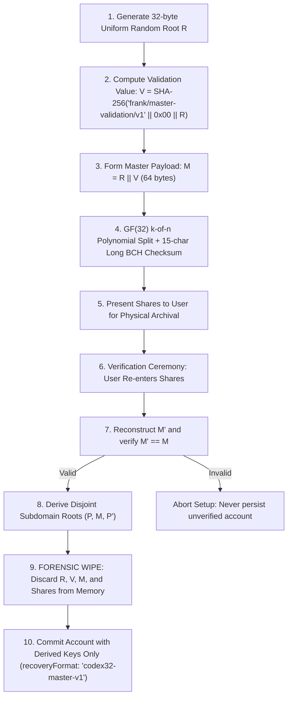

# GF(32) + Long-BCH Paper Backup & Codex32 Recovery Specification

**Status**: Design Specification  
**Implementation**: `packages/codex32` (`src/gf32-recovery-shares.ts`, `src/bip93-codex32.ts`), `packages/account-recovery`, `packages/account-vault`  
**Primary Specification**: `docs/codex32-signup-and-backup-specification.md`

---

## 1. Executive Summary

Frank uses a **$\text{GF}(32)$ polynomial threshold secret-sharing scheme with a 15-character long BCH checksum** to provide checksummed, threshold-recoverable paper backups for self-custodial accounts.

Unlike legacy BIP-39 mnemonics—which lack error detection, error correction, and native threshold splitting—Frank's $\text{GF}(32)$ recovery share scheme allows users to create $k$-of-$n$ shares (e.g. 2-of-3 or 3-of-5, as well as $k = 1$ single-share backups) encoded with the human-friendly 32-character alphabet (`qpzry9x8gf2tvdw0s3jn54khce6mua7l`).

---

## 2. Architectural Separation in `@frank/codex32`

`@frank/codex32` (`packages/codex32/src/`) separates Frank's production $\text{GF}(32)$ + long-BCH threshold recovery primitives from the optional BIP-93 `ms1...` compatibility codec while re-exporting both from `packages/codex32/src/index.ts` for zero caller breakage:

### 2.1 Core $\text{GF}(32)$ + 15-Character BCH Recovery Shares (`packages/codex32/src/gf32-recovery-shares.ts`)

Powers Frank's native `frk1...` / `fr1...` threshold recovery shares (including the 67-byte threshold secret-sharing scheme and 64-byte authenticated master payloads):

- **$\text{GF}(32)$ Polynomial Splitting & Interpolation**:
  - `splitGf32Symbols` / `splitRecoveryShares`: Splits arbitrary 5-bit symbol payloads over $\text{GF}(32)$ (reduced by $x^5 + x^3 + 1$) for thresholds $1 \le k \le 9$.
  - `interpolateGf32Symbols` / `combineRecoveryShares` (`RecoveryShareMetadata`): Evaluates Lagrange interpolation over $\text{GF}(32)$ to reconstruct the secret symbols at `s` (or verify/derive any share index), including degree-zero ($k = 1$) shares.
- **15-Character Long BCH Checksum Framing**:
  - `createLongBchChecksum` and `verifyLongBchChecksum`: Generalized 75-bit (15-symbol) BCH polymod checksum over an explicit human-readable prefix (HRP) and 5-bit symbol payload.
- **Canonical Symbol/Byte Packing & Master Payload Validation**:
  - `bytesToGf32Symbols` and `gf32SymbolsToBytes`: Lossless 8-bit to 5-bit symbol conversion with strict zero-padding verification.
  - `createMasterPayload` and `validateMasterPayload`: Constructs and verifies the 64-byte master payload $M = R \parallel \text{SHA-256}(\text{"frank/master-validation/v1"} \parallel \text{0x00} \parallel R)$.

### 2.2 Optional BIP-93 `ms1...` Compatibility Codec (`packages/codex32/src/bip93-codex32.ts`)

Provides strict compatibility with pinned BIP-93 (`ms1...`) strings (`encodeCodex32`, `decodeCodex32`, `validateCodex32Checksum`, `codex32SecretPayloadSymbols`, `interpolateCodex32Symbols`, `codex32SymbolsToBytes`, `splitCodex32`, `recoverCodex32Exact`, `recoverCodex32`) for legacy/interoperable `ms1...` vectors and ceremonies where $2 \le k \le 9$ or unshared $k = 0$ at index `s`.

### 2.3 Backwards-Compatible Storage Tag (`recoveryFormat: 'codex32-master-v1'`)

Although production recovery shares use the generalized $\text{GF}(32)$ + 15-character BCH scheme in `gf32-recovery-shares.ts` rather than standard `ms1...` BIP-93 strings, the persisted storage key and public recovery descriptor tag **`recoveryFormat: 'codex32-master-v1'`** (and `RECOVERY_FORMAT_ID = 'codex32-master-v1'`) **must remain unchanged**. Retaining `'codex32-master-v1'` preserves backwards compatibility with existing persisted vaults, public recovery descriptors (`frankdesc1...`), and deterministic recovery fingerprint commitments (`frank/recovery-fingerprint/v1`).

---

## 3. Master Secret & Verification Lifecycle

---

## 4. Key Design Invariants

1. **Zero Master Secret Retention**: Once domain keys ($P, M, P'$) are derived and verified during initial signup, raw root $R$ and master $M$ are completely purged from application memory. Frank never persists the root to local storage.
2. **Mandatory Pre-Commit Verification**: A new account cannot be finalized or funded until the user demonstrates the ability to restore $M$ by successfully entering their physical shares.
3. **No Implicit BIP-39 Conversion**: Self-custodial root accounts never convert BIP-39 mnemonics into `codex32-master-v1` roots; historical BIP-39 seeds use a distinct domain tag so derivation lineages remain cryptographically disjoint.
