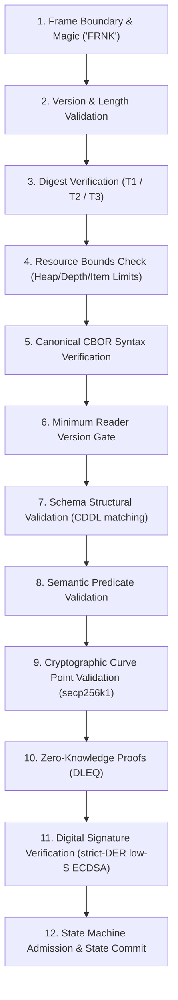

# Deterministic CBOR v1 (FRNK) Specification

**Status**: Normative Encoding and Validation Standard  
**Implementations**: `@frank/codec` (TypeScript), `frank-cbor` (Rust zero-copy parser)  
**Conformance Vectors**: `docs/protocol/cbor/vectors/`

---

## 1. Framing Architecture

Every independently stored, signed, hashed, or forwarded Frank object is serialized as an exact binary **frame**:

| Offset | Size | Field | Description |
| :---: | :---: | :--- | :--- |
| **0** | 4 bytes | Magic Bytes | ASCII `FRNK` (`0x46 0x52 0x4e 0x4b`) |
| **4** | 1 byte | Frame Version | Protocol frame version (`0x01`) |
| **5** | 4 bytes | Body Length | Big-endian uint32 payload length (bytes `9..N`) |
| **9** | $N$ bytes | CBOR Envelope | Canonical CBOR map `{ 0: type_id, 1: schema_version, 2: min_reader_version, 3: payload_bytes }` |

Worked example: a Type 17 text item `{0: "hi"}` (23 bytes total):

```text
46 52 4e 4b            FRNK (magic)
01                     frame version 1
00 00 00 0e            CBOR body length 14
a4                     envelope map, 4 entries
  00 11                  0: type_id = 17 (text-message-item)
  01 01                  1: schema_version = 1
  02 01                  2: min_reader_version = 1
  03 45                  3: payload = 5-byte string
     a1 00 62 68 69        payload map {0: "hi"}
```

---

## 2. Canonical Encoding Constraints (Strict CBOR)

To ensure byte-for-byte deterministic hashing across all languages (TypeScript, Rust, Go, Python):

1. **Integer Map Keys**: All protocol map keys MUST be unsigned integers (`uint`), serialized in strictly ascending numerical order without duplicates. Text or string keys are forbidden.
2. **Minimal Integer Representation**: Integers MUST use the shortest possible CBOR encoding (0–23 inline, 24–255 as 1-byte, 256–65535 as 2-byte, etc.).
3. **No Indefinite-Length Items**: Indefinite-length byte strings, text strings, arrays, or maps are strictly rejected.
4. **No Floating-Point Values**: IEEE 754 float types are disallowed in protocol records to prevent architecture-dependent precision loss.
5. **Exact UTF-8 String Encoding**: Text strings MUST be valid UTF-8, with no unassigned Unicode code points or invalid surrogate pairs.
6. **Zero Trailing Bytes**: The CBOR payload must consume exactly the remaining bytes of the frame. Trailing data is a fatal deserialization error.

---

## 3. Type ID Allocation Registry

Generated from `docs/protocol/message-types/v1.json`, the authoritative list (see its README).

<!-- BEGIN GENERATED: message-types (docs/protocol/message-types/generate.py) -->

| Type ID |   Hex    | Name                                             | CDDL Schema Rule                 | Description                                                                                                   |
| :-----: | :------: | :----------------------------------------------- | :------------------------------- | :------------------------------------------------------------------------------------------------------------ |
|  **1**  | `0x0001` | Directory Statement                              | `directory-statement`            | Account-to-relay binding, public keys ($P, M, P'$), and revision                                              |
|  **2**  | `0x0002` | Directory Attestation                            | `directory-attestation`          | Wraps and signs a Type 1 directory statement with ECDSA                                                       |
|  **3**  | `0x0003` | Key Transition Statement                         | `key-transition-statement`       | Cryptographic authorization linking a retiring key to a new subject key                                       |
| **10**  | `0x000a` | Direct Message Delivery                          | `direct-message-delivery`        | Outermost DKSAP message container with payment stamps                                                         |
| **11**  | `0x000b` | Recipient Encrypted Payload                      | `recipient-encrypted-payload-v2` | XChaCha20-Poly1305 ciphertext with DLEQ zero-knowledge proof                                                  |
| **12**  | `0x000c` | Encrypted Message Content                        | `encrypted-message-content`      | Inner decrypted container with logical message ID & payload                                                   |
| **13**  | `0x000d` | Forwarding Delivery Envelope                     | `forwarding-delivery-envelope`   | Store-and-forward relay hop delivery envelope with storage stamps (up to 32 MiB)                              |
| **14**  | `0x000e` | Mailbox Checkpoint                               | `mailbox-checkpoint`             | Durable journal facts and mailbox state checkpoint                                                            |
| **20**  | `0x0014` | Message Content Revision                         | `message-content-revision`       | Ordered array of semantic message items                                                                       |
| **21**  | `0x0015` | Container Message Item                           | `container-message-item`         | Opaque nested child frame container for multi-item deliveries                                                 |
| **22**  | `0x0016` | UTF-8 Text Item                                  | `text-message-item`              | Plaintext chat message text up to 256 KiB                                                                     |
| **23**  | `0x0017` | Email Bridge Message Item                        | `email-message-item`             | Email carried through a gateway: parties, subject, bodies, references and attachments                         |
| **24**  | `0x0018` | Stealth Payment Item                             | `stealth-message-item`           | Single-use ephemeral DKSAP on-chain transfer notification                                                     |
| **25**  | `0x0019` | Universal State Channel Update                   | `channel-update-item`            | Instant off-chain multi-network state execution and interactive turns                                         |
| **26**  | `0x001a` | Blackjack Message Item                           | `blackjack item (closed shapes)` | Peer-to-peer blackjack hand and move items (closed payload shapes, up to 4 KiB)                               |
| **27**  | `0x001b` | Generic Plugin Message Item                      | `plugin-message-item`            | Application item type identifier with the owning plugin's opaque bytes (up to 512 KiB)                        |
| **40**  | `0x0028` | Topic Post Content                               | `topic-post`                     | Public forum post content with structured authored entries                                                    |
| **41**  | `0x0029` | Topic Post Submission                            | `topic-post-submission`          | Initial post creation paired with raw signed on-chain burn transaction ($T_7$)                                |
| **42**  | `0x002a` | Topic Vote Submission                            | `topic-vote-submission`          | Upvote on existing post paired with raw signed on-chain burn transaction ($T_7$)                              |
| **43**  | `0x002b` | Forum Post Observation                           | `forum-single-view`              | Single post observation paired with author address, raw signed burn tx, and vote weight                       |
| **44**  | `0x002c` | Forum Topic Batch (`forum-topic-page`)           | `forum-topic-page`               | Paginated batch of up to 128 post observation frames within a topic, with continuation cursor and relay epoch |
| **45**  | `0x002d` | Forum Discovery Listing (`forum-discovery-page`) | `forum-discovery-page`           | Paginated directory of active topics, post counts, and last activity timestamps                               |
| **46**  | `0x002e` | Forum Operation Status                           | `forum-operation-status`         | Relay submission/confirmation status report for an on-chain burn transaction                                  |

<!-- END GENERATED: message-types -->

> [!NOTE]
> **Database Pagination vs. Web Pages**: In Types 13 and 14 (`forum-topic-page` and `forum-discovery-page`), the term **"Page"** refers strictly to cursor-based database query result sets (holding up to 128 verified post observations with continuation cursors), not HTML documents or rendered web pages.

---

## 4. Multi-Stage Validation Order

Implementations MUST process frames through twelve rigorous validation stages:


