# Content-Addressed Encrypted Blob Storage & Attachments

- **Status**: Standard (Track C, Issues #452, #453, #983)
- **Scope**: Content-oblivious encrypted attachment manifests (`EncryptedAttachmentManifest`), deterministic per-chunk AEAD nonce/AAD derivation, chunked staging and reference-counted garbage collection lifecycle, and the unified `BlobStore` trait across `RocksDbBlobStore`, `LocalFsBlobStore`, and `S3BlobStore`.

---

## 1. Architectural Motivation & Content-Oblivious Boundary

In high-throughput federated messaging, embedding large files (images, audio notes, video streams, PDF documents) directly inside single-transaction database write batches causes write amplification, LSM compaction stalls, and memory spikes.

Frank decouples the control plane from the bulk ciphertext data plane while enforcing a **strict content-oblivious boundary**:

- **Control Plane (`RelayKvStore`)**: Compact envelopes ($\le 64\text{ KiB}$), canonical Frank-CBOR attachment manifests (`B_man:`), staging session states (`B_stg_ses:`), and owner reference counts (`B_ref:`) are persisted in the transactional `RelayKvStore` (RocksDB or FoundationDB).
- **Data Plane (`BlobStore`)**: Bounded ciphertext chunks ($\le 1\text{ MiB}$, default $256\text{ KiB}$) are stored in `RocksDbBlobStore`, `LocalFsBlobStore`, or `S3BlobStore` (AWS S3, MinIO, Cloudflare R2, SeaweedFS).
- **Zero Application Metadata in `BlobStore`**: Neither `EncryptedAttachmentManifest` nor `BlobStore` contains filenames, MIME types, media kinds, image/video dimensions, audio durations, thumbnails, call associations, or commerce semantics. All application metadata lives exclusively inside the end-to-end encrypted `Type 8` (`ApplicationItem`) message payload alongside the 256-bit symmetric key $K_{\text{blob}}$ and 24-byte `base_nonce`.

---

## 2. Two-Level Opaque Identification & Per-Chunk Cryptography

### 2.1 Two-Level Identifiers (`AttachmentId` + `ChunkDigest`)

1. **`AttachmentId([u8; 32])`**: A fresh 256-bit random capability-scoped identifier generated per upload. Addressing manifests and published chunk namespaces by random `AttachmentId` rather than a global plaintext or unkeyed ciphertext hash prevents cross-user confirmation-of-a-file attacks and deduplication side channels.
2. **`ChunkDigest([u8; 32])`**: The `SHA-256` digest of each individual encrypted chunk's ciphertext bytes (`SHA-256(chunk_ciphertext_i)`). Every staged upload, publication promotion, single-chunk read, and byte-range read verifies the chunk's `SHA-256` against the manifest before returning bytes.

### 2.2 Deterministic Per-Chunk Nonce & AAD Derivation

To prevent chunk reordering, truncation, duplication, or cross-attachment chunk splicing, each chunk $i \in [0, N)$ is encrypted with `XChaCha20-Poly1305` under $K_{\text{blob}}$ using a domain-separated per-chunk nonce and AAD:

$$\text{mask}_i = \text{HMAC-SHA256}\bigl(K_{\text{blob}},\ \texttt{"frank-blob-chunk-v1"} \parallel \text{attachment\_id} \parallel \text{u32\_be}(i)\bigr)[0..24]$$

$$\text{nonce}_i = \text{base\_nonce} \oplus \text{mask}_i$$

$$\text{aad}_i = \texttt{"frank-blob-aad-v1"} \parallel \text{attachment\_id} \parallel \text{u32\_be}(i) \parallel \text{u8}(\text{is\_final\_chunk})$$

---

## 3. Canonical Frank-CBOR `EncryptedAttachmentManifest` Schema

Manifests are encoded and decoded using deterministic `frank_cbor` (`encode_canonical` / `decode_canonical`) with unsigned integer map keys. Unknown keys $> 6$ are retained in `extra_fields: BTreeMap<i128, CborValue>` for forward-compatible version negotiation.

### 3.1 Top-Level Manifest Map Keys

| CBOR Key | Field Name | Rust Type | Normative Constraints |
| :--- | :--- | :--- | :--- |
| `1` | `schema_version` | `u32` | Must equal `1` (`MANIFEST_SCHEMA_VERSION`). |
| `2` | `attachment_id` | `[u8; 32]` | 32-byte opaque capability-scoped attachment ID. |
| `3` | `total_ciphertext_bytes` | `u64` | Exact sum of `byte_len` across all chunks ($\le 256\text{ MiB}$). |
| `4` | `max_chunk_bytes` | `u32` | Bounded in $1..\!=\!1{,}048{,}576$ ($1\text{ MiB}$); default $262{,}144$ ($256\text{ KiB}$). |
| `5` | `chunks` | `Vec<ManifestChunkSpec>` | Ordered array of chunk descriptors ($\le 4096$ chunks). |
| `6` | `expires_at_ms` | `u64` | Unix epoch milliseconds when the published attachment expires. |
| $> 6$ | `extra_fields` | `BTreeMap<i128, CborValue>` | Losslessly retained unknown future fields. |

### 3.2 `ManifestChunkSpec` Map Keys

| CBOR Key | Field Name | Rust Type | Normative Constraints |
| :--- | :--- | :--- | :--- |
| `1` | `index` | `u32` | Strictly contiguous $0..\text{chunks.len()}$. |
| `2` | `byte_len` | `u32` | Ciphertext byte length in $1..\!=\!\text{max\_chunk\_bytes}$. |
| `3` | `sha256` | `[u8; 32]` | `SHA-256` digest over the chunk's ciphertext bytes. |

### 3.3 Resource Limits Enforced Before Allocation

- `MAX_MANIFEST_BYTES`: `65_536` ($64\text{ KiB}$)
- `DEFAULT_CHUNK_BYTES`: `262_144` ($256\text{ KiB}$)
- `MAX_CHUNK_BYTES`: `1_048_576` ($1\text{ MiB}$)
- `MAX_CHUNK_COUNT`: `4_096`
- `MAX_ATTACHMENT_BYTES`: `268_435_456` ($256\text{ MiB}$)

---

## 4. Stage $\rightarrow$ Publish $\rightarrow$ Reference / GC State Machine

```mermaid
stateDiagram-v2
    [*] --> Staged: begin_staging(session_id, manifest, ttl)
    Staged --> Staged: put_staged_chunk(session_id, idx, bytes)\n[verifies len + SHA-256; idempotent on retry]
    Staged --> Published: publish_staged(session_id, now_ms, owner_ref)\n[promotes chunks + atomic KV manifest/ref commit]
    Staged --> Reclaimed: gc_expired(now_ms >= staged_expires_at_ms)
    Published --> Published: add_reference / remove_reference (> 0 refs remaining)
    Published --> Tombstoned: gc_expired(expires_at_ms <= now_ms OR refs == 0)\n[atomic KV delete B_man + write B_gc tombstone]
    Tombstoned --> Reclaimed: gc_expired deletes published chunks + B_gc tombstone
```

### 4.1 Crash-Boundary Invariant Table

| Crash Boundary | Durable KV State | Chunk Store State | Reader Visibility | Recovery / GC Behavior |
| :--- | :--- | :--- | :--- | :--- |
| Mid `put_staged_chunk` before `B_stg_got` write | `B_stg_ses` present, `B_stg_got` absent | Staged chunk present | Invisible (`NotFound`) | Client retry overwrites staged chunk idempotently; or `gc_expired` deletes staged chunk when session TTL expires. |
| Mid `publish_staged` during chunk promotion (before KV commit) | `B_stg_ses` present, `B_man` absent | Partial published chunks written | Invisible (`NotFound`) | Retry of `publish_staged` completes promotion; if abandoned, `gc_expired` deletes both staged and unreferenced published chunks. |
| Mid `publish_staged` after atomic KV commit, before staged chunk deletion | `B_man`, `B_ref`, and `B_cln` committed; `B_stg_ses` deleted | Published chunks intact; some staged chunks remain | **Readable & verified** | Next `gc_expired` sweeps `B_cln` and deletes leftover staged chunks without touching published chunks. |
| Mid `gc_expired` after atomic unpublish transaction, before chunk deletion finishes | `B_man` and `B_ref` deleted; `B_gc` tombstone committed | Some published chunks still on disk/S3 | Invisible (`NotFound`) | Next `gc_expired` sweeps `B_gc`, deletes remaining published chunks, and removes `B_gc`. |

---

## 5. `BlobStore` Adapters & S3 Compatibility (`#453`)

1. **`RocksDbBlobStore`**: Persists manifests/references in `RelayKvStore` and stores bounded chunks under `B_stg:{session_id}:{idx}` and `B_chk:{attachment_id}:{idx}` in `RelayKvStore`, avoiding multi-megabyte monolithic WriteBatches.
2. **`LocalFsBlobStore`**: Persists manifests/references in `RelayKvStore` and writes immutable chunk files under `root_dir/staging/{session_hex}/{idx}.chunk` and `root_dir/chunks/{prefix}/{attachment_hex}/{idx}.chunk` using atomic temp-file write + `fsync` + `rename`.
3. **`S3BlobStore`**: Persists authoritative manifests/references in `RelayKvStore` and stores immutable chunk payloads in S3-compatible object storage using only the portable S3 REST subset (`PUT`, `GET`, `HEAD`, `DELETE` with AWS SigV4 `Authorization` and `x-amz-content-sha256` payload verification). This subset works identically across AWS S3, MinIO, Cloudflare R2, and SeaweedFS without relying on provider-specific multipart-upload state or eventual-consistency bucket listing.

---

## 6. Threat Model Summary

| Actor / Layer | What It Can Observe | What It Cannot Learn or Alter |
| :--- | :--- | :--- |
| **Relay / `RelayKvStore`** | Opaque `AttachmentId`, chunk count, per-chunk ciphertext sizes, `expires_at_ms`, and message `owner_ref` digests. | Plaintext bytes, $K_{\text{blob}}$, filename, MIME type, media dimensions, or whether two users uploaded the same file. |
| **S3 / Object Storage Provider** | Opaque object keys (`staging/{session}/{idx}`, `chunks/{attachment_id}/{idx}`), ciphertext byte lengths, and `SHA-256` digests. | Cannot forge, reorder, truncate, or splice chunks undetected: `BlobStore::get_chunk` and `BlobStore::read_range` verify `SHA-256` against the signed manifest, and clients verify per-chunk XChaCha20-Poly1305 AEAD tags bound to `derive_chunk_nonce` and `derive_chunk_aad`. |
