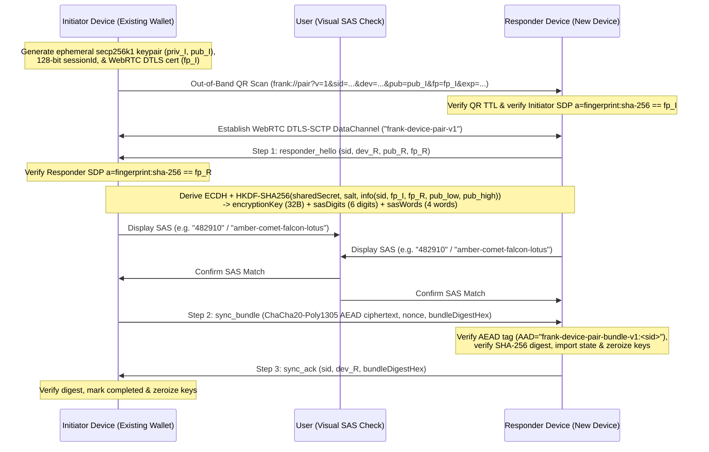

# Frank Instant Multi-Device QR Pairing & E2EE State Sync (`frank-device-pair-v1`, `#1704`)

This document specifies Frank's peer-to-peer multi-device onboarding and end-to-end encrypted (E2EE) state synchronization protocol (`#1704`), enabling an existing authenticated Frank wallet device (**Initiator**) to pair a new desktop or mobile device (**Responder**) by scanning an out-of-band QR code (`frank://pair?...`) and transferring encrypted wallet state over a WebRTC `RTCDataChannel` (`frank-device-pair-v1`).

---

## 1. Architecture & Protocol Flow



---

## 2. Pairing QR URI Schema (`frank://pair`)

The Initiator encodes a `DevicePairingQrPayload` as a compact `frank://pair?...` URI with a default time-to-live of `DEFAULT_PAIRING_TTL_MS = 180_000` (3 minutes):

```text
frank://pair?v=1&sid=<32-hex>&dev=<deviceId>&pub=<66-hex-compressed-secp256k1>&fp=<AA:BB:...:FF>&exp=<epochMs>[&relay=<url>]
```

| Query Param | `DevicePairingQrPayload` Field | Format / Validation Rules |
| :---: | :--- | :--- |
| `v` | `version` | Must be `1` (`DEVICE_PAIRING_PROTOCOL_VERSION`) |
| `sid` | `sessionId` | 32 lowercase hex characters (16 CSPRNG bytes) |
| `dev` | `initiatorDeviceId` | `1..128` printable non-whitespace ASCII characters (`[\x21-\x7e]`) |
| `pub` | `initiatorEphemeralPubKeyHex` | 66 hex characters (`02` or `03` prefix) representing a valid on-curve compressed `secp256k1` point |
| `fp` | `dtlsFingerprintSha256` | Canonical uppercase 32-byte colon-separated SHA-256 fingerprint (`AA:BB:...:FF`); `sha-1`, `md5`, all-`00`, and all-`FF` are rejected |
| `exp` | `expiresAtMs` | Positive Unix epoch milliseconds (`nowMs < expiresAtMs`) |
| `relay` | `relayUrl` *(optional)* | Optional signaling endpoint (`https:`, `http:`, `wss:`, or `ws:`) |

---

## 3. Mutual Cryptographic Binding & Short Authentication String (SAS)

Even though WebRTC `RTCDataChannel` uses DTLS encryption, an untrusted signaling relay could attempt an active man-in-the-middle (MITM) attack by substituting the Responder's DTLS certificate or ephemeral public key during signaling.

`deriveDevicePairingKeys` prevents both attacks by cryptographically binding the **ECDH shared secret** and **both peers' WebRTC DTLS SHA-256 certificate fingerprints** into a single HKDF-SHA256 key schedule:

1. **ECDH Shared Secret**:
   $$\text{sharedSecret} = \text{secp256k1.getSharedSecret}(\text{priv}_{\text{local}}, \text{pub}_{\text{remote}}, \text{compressed}=\text{true})$$
   Public key reflection ($\text{pub}_{\text{local}} == \text{pub}_{\text{remote}}$) is rejected fail-closed.
2. **Canonical Transcript Binding**:
   - $\text{salt} = \text{SHA256}(\texttt{"frank-device-pair-salt-v1:"} \parallel \text{sessionId})$
   - Let $(\text{pub}_{\text{low}}, \text{pub}_{\text{high}})$ be the lexicographically sorted pair of $(\text{pub}_I, \text{pub}_R)$.
   - $\text{info} = \texttt{"frank-device-pair-transcript-v1|"} \parallel \text{sessionId} \parallel \texttt{"|"} \parallel \text{fp}_I \parallel \texttt{"|"} \parallel \text{fp}_R \parallel \texttt{"|"} \parallel \text{pub}_{\text{low}} \parallel \texttt{"|"} \parallel \text{pub}_{\text{high}}$
   - $\text{OKM}_{64} = \text{HKDF-SHA256}(\text{sharedSecret}, \text{salt}, \text{info}, 64)$
3. **Key & SAS Split**:
   - `encryptionKey` = $\text{OKM}[0..31]$ (256-bit ChaCha20-Poly1305 key)
   - `sasMaterial` = $\text{OKM}[32..63]$
   - `transcriptHashHex` = $\text{hex}(\text{SHA256}(\text{sasMaterial}))$
   - `sasDigits`: 6-digit zero-padded integer $(\text{uint32\_be}(\text{sasMaterial}[0..3]) \bmod 1{,}000{,}000)$
   - `sasWords`: 4 high-contrast words indexed by $\text{sasMaterial}[4..7] \pmod{64}$ from `SAS_WORDLIST`.

---

## 4. Application-Layer E2EE State Sync Bundle (`DeviceSyncBundle`)

In addition to transport-layer DTLS, the wallet state bundle (`DeviceSyncBundle`) is encrypted end-to-end at the application layer using **ChaCha20-Poly1305** (`@noble/ciphers/chacha`):

- **Cipher**: `chacha20poly1305(encryptionKey, nonce12, aad)`
- **AAD**: `utf8ToBytes("frank-device-pair-bundle-v1:" + sessionId)`
- **Integrity Digest**: `bundleDigestHex = sha256(plaintextUtf8Bytes)`
- **Zeroization**: Both `DevicePairingHandshakeMachine` instances automatically overwrite `ephemeralPrivKey` and `encryptionKey` with zeros (`zeroizePairingKeys`) immediately upon completion, failure, abort, or TTL expiration.

---

## 5. Threat Model (`#1704`)

| Threat / Attack Vector | Adversary Capability | Protocol Mitigation | Enforcement Function |
| :--- | :--- | :--- | :--- |
| **Initiator DTLS MITM** | Signaling relay swaps Initiator's SDP `a=fingerprint` | Responder compares Initiator SDP fingerprint in constant time against QR `dtlsFingerprintSha256` scanned via camera | `DevicePairingHandshakeMachine.createResponder` |
| **Responder DTLS or ECDH MITM** | Signaling relay swaps Responder's SDP `a=fingerprint` or `responder_hello` public key | Both `fp_I`, `fp_R`, `pub_I`, and `pub_R` are bound into HKDF `info`; any substitution alters `sasDigits`, `sasWords`, and `encryptionKey` | `deriveDevicePairingKeys`, `handleResponderHello` |
| **Pre-SAS Bundle Exfiltration** | Malicious responder tries to obtain `sync_bundle` without user confirmation | Initiator refuses to encrypt/send `sync_bundle` and Responder refuses to decrypt until explicit SAS confirmation | `confirmSasAndSendBundle`, `handleSyncBundle` |
| **Cross-Session Replay** | Attacker replays an encrypted `sync_bundle` into another pairing session | ChaCha20-Poly1305 AAD binds `frank-device-pair-bundle-v1:<sessionId>` alongside fresh per-session ECDH keys | `encryptDeviceSyncBundle`, `decryptDeviceSyncBundle` |
| **Stale QR Code Capture** | Attacker photographs an unattended pairing QR screen after 3 minutes | Strict `expiresAtMs` check (`DEFAULT_PAIRING_TTL_MS = 180_000`) enforced on URI parse and every state machine transition | `parseDevicePairingUri`, `checkTimeout` |
| **Post-Pairing Memory Forensics** | Heap inspection after pairing finishes or fails | Ephemeral private keys, HKDF intermediates, plaintext buffers, and `encryptionKey` are zeroized in-place via `.fill(0)` | `zeroizePairingKeys` |
