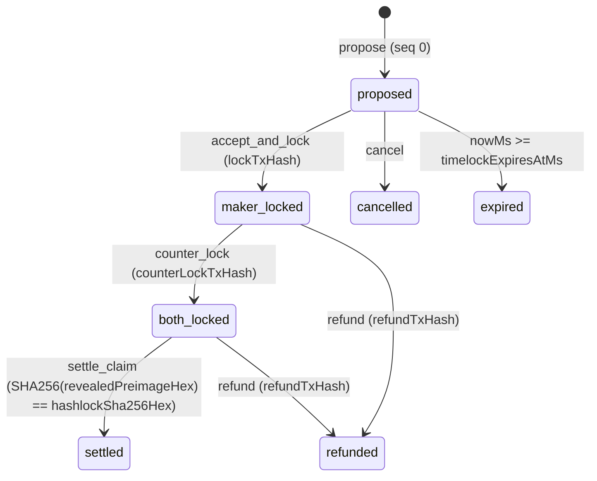

# In-Chat P2P OTC Swap & Escrow Handshake Protocol (`swap-handshake-v1`)

> **Issue**: `#1705` — In-chat P2P OTC Swap & Escrow Handshake Cards with multi-device execution leases  
> **Plugin ID**: `swap-handshake-v1`  
> **Schema Version**: `1`

## 1. Overview

`swap-handshake-v1` enables two peers in an end-to-end encrypted Frank conversation to negotiate, lock, and atomically settle cross-chain Over-The-Counter (OTC) swaps (`atomic_swap`) and milestone-based escrows (`milestone_escrow`) directly inside chat bubbles without relying on centralized escrow custodians or fragile device-local secret storage.

The protocol solves two fundamental failure modes of traditional multi-device messaging wallets:

1. **Stranded HTLC Preimages on Device Loss / Disconnect**: If a user initiates an atomic swap on their phone and their phone loses connectivity after both sides lock funds on-chain, a random device-local preimage would strand the swap until timelock expiry. `swap-handshake-v1` derives all per-swap cryptographic material deterministically from `(masterSeed, swapId, role)` via HKDF-SHA256. Any secondary device (e.g., laptop) synced to the same wallet seed and reading the chat transcript (`swapId`) derives the exact same preimage, hashlock, adaptor scalar, and ephemeral signing seed.
2. **Double-Broadcast Race Across Concurrent Open Frontends**: If a user has both phone and desktop open simultaneously, both devices could observe an incoming `counter_lock` message and attempt to broadcast competing settlement transactions. Every `swap-handshake-v1` step carries an explicit execution lease (`executorDeviceId`, `leaseExpiresAtMs`). Secondary devices suppress automatic execution while the leader device's lease is active (`nowMs < leaseExpiresAtMs`) and expose an explicit **"Resume on This Device"** (`lease_heartbeat`) failover action once the lease expires.

---

## 2. Deterministic Per-Swap Cryptographic Secret Derivation

Given:
- `masterSeed`: Wallet root seed (`Uint8Array`, $\ge 16$ bytes)
- `swapId`: Unique swap identifier (`1..128` ASCII characters)
- `role`: `'maker' | 'taker'`

`deriveSwapSecrets` computes 96 bytes of output keying material (OKM) using HKDF-SHA256:

```text
salt = UTF8("frank-swap-handshake-salt-v1")
info = UTF8("frank-swap-v1:" || swapId || ":" || role)
okm  = HKDF-SHA256(ikm = masterSeed, salt = salt, info = info, length = 96)
```

The 96-byte OKM is partitioned into three 32-byte domain-separated secrets:

| Byte Slice | Field | Purpose |
| :--- | :--- | :--- |
| `okm[0..32]` | `preimage` (`32 bytes`) | HTLC secret preimage $R$; `hashlockSha256 = SHA256(preimage)` |
| `okm[32..64]` | `adaptorSecretScalar` (`32 bytes`) | Scriptless adaptor signature secret scalar $t$ |
| `okm[64..96]` | `ephemeralSigningSeed` (`32 bytes`) | Per-swap ephemeral keypair seed for HTLC / escrow scripts |

---

## 3. Multi-Device Execution Lease & Failover Protocol

Every `SwapHandshakePayload` carries:
- `executorDeviceId: string` — identifier of the device emitting the step and claiming the execution lease for its side (`maker` or `taker`).
- `leaseExpiresAtMs: number` — UTC millisecond timestamp until which `executorDeviceId` holds exclusive execution authority (`DEFAULT_SWAP_LEASE_DURATION_MS = 60_000` ms).

For any local frontend with `localDeviceId` evaluated at `nowMs`:

```ts
isLocalDeviceLeader      = (executorDeviceId === localDeviceId)
isLeaseExpired           = (nowMs >= leaseExpiresAtMs)
canLocalDeviceExecute    = isLocalDeviceLeader || isLeaseExpired
requiresFailoverTakeover = (executorDeviceId !== localDeviceId) && isLeaseExpired
```

- **Active Leader (`isLocalDeviceLeader === true`)**: Allowed to sign, broadcast, and emit the next protocol step.
- **Standby Follower (`!canLocalDeviceExecute`)**: Renders `"Executing on another device (<executorDeviceId>)"` and disables duplicate transaction broadcast buttons.
- **Failover Takeover (`requiresFailoverTakeover === true`)**: When the previous device's lease expires (`nowMs >= leaseExpiresAtMs`), the standby device enables **"Resume on This Device"** (`action: 'lease_heartbeat'`), transferring `executorDeviceId` to `localDeviceId` with a fresh `leaseExpiresAtMs`.

---

## 4. State Machine & Transcript Folding (`foldSwapHandshakeState`)



### Verification Invariants
- **Monotonic Sequence**: Steps for a given `swapId` are ordered by `sequence` (`0, 1, 2, ...`). Duplicate or stale sequences are ignored.
- **Cryptographic Preimage Verification on Settlement**: A `settle_claim` step is **only** accepted into the `settled` state if `revealedPreimageHex` is a valid 32-byte hex string whose SHA-256 digest matches `hashlockSha256Hex` in constant time:
  $$\operatorname{SHA256}(\text{revealedPreimageHex}) \equiv \text{hashlockSha256Hex}$$
  Any `settle_claim` with a missing or mismatched preimage is rejected by `foldSwapHandshakeState`.
- **Canonical CBOR Wire Format**: All `SwapHandshakePayload` items are encoded using deterministic integer-keyed canonical CBOR maps (`0..18`) inside `ApplicationMessageItem` (`itemType: 'swap-handshake-v1'`).
