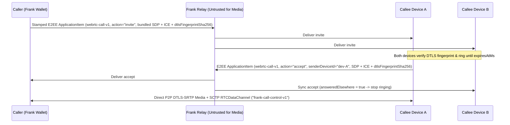
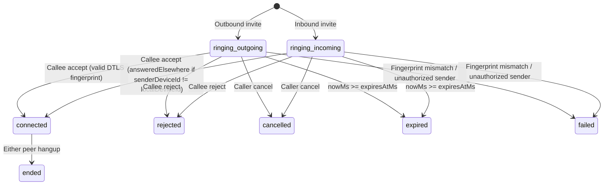

# Frank WebRTC Calling Protocol (`webrtc-call-v1`)

This document specifies Frank's peer-to-peer and group WebRTC calling architecture (`#462`–`#469`), designed to operate over existing Frank stamped, end-to-end encrypted (`x25519-xsalsa20-poly1305`) `MessageWrapper` envelopes with **zero relay or wire breaking changes**.

---

## 1. Design Principles & Architecture Overview

1. **Zero Relay / Wire Breaking Changes (`#462`)**:
   - Call signaling travels inside standard Frank `ApplicationItem` (`type = 28`, `itemType = "webrtc-call-v1"`) payloads encoded as canonical CBOR (`@frank/codec`).
   - Every call invitation (`action = "invite"`) is carried by a normal stamped, E2EE Frank message. The caller's attached stamp payment serves as proof-of-work / economic anti-spam protection against unsolicited ring flooding.
2. **Two-Message Bundled ICE + Direct P2P Control (`#462`, `#463`, `#464`, `#466`)**:
   - **Call Setup (2 Stamped Messages)**:
     1. `invite`: Carries the caller's complete SDP offer, bundled ICE candidates gathered up to a short deadline, media intent (`audio` | `video` | `screen`), ICE transport policy (`direct-preferred` | `relay-only` | `direct-only`), ring expiry (`expiresAtMs`), and the caller's ephemeral DTLS certificate `sha-256` fingerprint (`dtlsFingerprintSha256`).
     2. `accept`: Carries the callee's complete SDP answer, bundled ICE candidates, `senderDeviceId`, and the callee's ephemeral DTLS certificate `sha-256` fingerprint (`dtlsFingerprintSha256`).
   - **In-Call Control & Media Renegotiation (0 Stamped Messages)**:
     - Once the DTLS-SRTP / SCTP peer connection is established, all mid-call state updates (`mute_state`, `renegotiate_offer`, `renegotiate_answer`, `hangup`, `ping`, `pong`) flow directly peer-to-peer over a negotiated `RTCDataChannel` labeled `"frank-call-control-v1"`.
     - If a call is cancelled, declined, or torn down before the P2P DataChannel opens, `cancel`, `reject`, or fallback `hangup` items flow over the Frank signaling channel.
3. **Cryptographic Identity Binding to DTLS-SRTP (`#462`)**:
   - WebRTC media encryption uses DTLS-SRTP with ephemeral self-signed certificates. Without out-of-band authentication of the certificate fingerprint, an active network or TURN/relay adversary that modifies SDP could mount a DTLS man-in-the-middle attack.
   - Because Frank `webrtc-call-v1` payloads are encrypted and authenticated by the sender's Frank identity key, both peers verify in constant time (`verifyRemoteSdpFingerprint`) that the remote SDP's `a=fingerprint:sha-256` attribute across all media (`m=`) sections matches the Frank-authenticated `dtlsFingerprintSha256` field.
   - Weak hash algorithms (`sha-1`, `md5`) and multi-`m=`-line fingerprint mismatches are rejected fail-closed.

---

## 2. Threat Model (`#462`–`#469`)

| Threat / Attack Vector | Adversary Capability | Protocol Mitigation | Enforcement Function / Layer |
| :--- | :--- | :--- | :--- |
| **DTLS-SRTP MITM / SDP Tampering** | Active network or malicious relay attempting to substitute SDP `a=fingerprint` | `dtlsFingerprintSha256` travels inside Frank E2EE ciphertext; constant-time match against every `m=` section's `a=fingerprint:sha-256`; `sha-1`/`md5` rejected | `extractSdpDtlsFingerprintSha256`, `verifyRemoteSdpFingerprint` |
| **Mid-Call Renegotiation Hijack** | Peer or MITM attempting to swap DTLS certificate during audio-to-video/screen upgrade | P2P `RTCDataChannel` (`frank-call-control-v1`) enforces that `renegotiate_offer` / `renegotiate_answer` preserve the peer's initial authenticated `dtlsFingerprintSha256` | `decodeDataChannelMessage` |
| **Unsolicited Ring Spam / DoS** | Attacker flooding `invite` messages to trigger continuous ringing | `invite` requires a valid Frank stamp payment (`#462`), bounded `expiresAtMs` TTL, and per-sender rate/contact policy | Stamped `MessageWrapper` + `foldWebRtcCallState` |
| **Cross-Call / Third-Party Signaling Injection** | Third party injecting `accept`, `reject`, `cancel`, or `ice_batch` into an active `callId` | Strict participant & role authorization: only caller may `cancel`; only callee may `accept`/`reject`; third-party senders trigger `phase: "failed"` with `securityError` | `foldWebRtcCallState` |
| **Local / Public IP Disclosure via ICE** | Remote peer harvesting local LAN (`typ host`) or public NAT (`typ srflx`) IP addresses from SDP/ICE | Strict `relay-only` mode sets `iceTransportPolicy: "relay"`, strips `typ host`/`srflx`/`prflx` and `raddr`/`rport` from outgoing SDP and candidate arrays, and masks `c=IN IP4/IP6` to `0.0.0.0` | `sanitizeSdpForIcePolicy`, `filterCandidateForIcePolicy`, `buildRtcConfiguration` |
| **Stale SDP / ICE Metadata Persistence** | Post-call inspection of local message state exposing historical candidate IPs/ports | Aggressive terminal redaction: once a call enters `rejected`, `cancelled`, `expired`, `ended`, or `failed`, `offerSdp`, `answerSdp`, and `candidates` are redacted to `null` / `[]` | `foldWebRtcCallState` |
| **TURN Relay Credential Abuse** | Theft or long-term reuse of static TURN credentials | Ephemeral HMAC-SHA1 coturn REST credentials (`<expires>:<account>:<callId>`) scoped to a short TTL (`<= 300s` default) | `issueTurnRestCredentials`, `verifyTurnRestCredentials` |
| **Suspended Mobile / PWA Ghost Ringing** | Push notification waking device after call was already cancelled, expired, or answered on desktop | Wakeup handler catches up message batch and folds call state before ringing (`shouldRing: false` on `cancelled`, `expired`, `answeredElsewhere`, `duplicate_wakeup`) | `evaluateWakeupCallInvite` |
| **Untrusted SFU Media Eavesdropping / Forgery (`#469`)** | Group call SFU inspecting or splicing media frames across calls, epochs, or senders | End-to-end SFrame encryption (`frank-sframe-v1`) with HKDF-SHA256 per-sender keys, AAD binding `(callId, epoch, keyId, frameCounter, mediaType, ssrc)`, and mandatory epoch rotation on join/leave | `deriveSFrameEpochKey`, `buildSFrameHeader`, `verifySFrameEpochTransition` |

---

## 3. Wire Schema (`webrtc-call-v1`, `#462`)

`webrtc-call-v1` is registered as an `ApplicationItem` (`type: "application"`, `itemType: "webrtc-call-v1"`). Its canonical CBOR map uses integer keys `0..11`:

| CBOR Key | Field Name | Type | Constraints |
| :---: | :--- | :--- | :--- |
| `0` | `schemaVersion` | `1` | Must be `1` |
| `1` | `callId` | `string` | `16..64` ASCII `[a-zA-Z0-9_-]` characters |
| `2` | `action` | `string` | `'invite' \| 'accept' \| 'reject' \| 'cancel' \| 'hangup' \| 'ice_batch'` |
| `3` | `sequence` | `number` | Non-negative safe integer (`0..2^53-1`) |
| `4` | `senderDeviceId` | `string` | `1..128` printable non-whitespace ASCII characters |
| `5` | `mediaIntent` | `string?` | `'audio' \| 'video' \| 'screen'` |
| `6` | `icePolicy` | `string?` | `'direct-preferred' \| 'relay-only' \| 'direct-only'` |
| `7` | `sdp` | `string?` | Required on `invite` and `accept`; `1..65536` UTF-8 bytes |
| `8` | `dtlsFingerprintSha256` | `string?` | Required on `invite` and `accept`; canonical uppercase `AA:BB:...:FF` (32 bytes) |
| `9` | `candidates` | `string[]?` | Optional dense array of `0..64` ICE candidate lines |
| `10` | `expiresAtMs` | `number?` | Required on `invite`; positive Unix epoch milliseconds |
| `11` | `reason` | `string?` | Optional termination reason (`<= 280` chars) |

### Simultaneous Invite Glare Resolution
If two peers simultaneously send `invite` payloads to one another, both peers deterministically select the winning offer via `resolveGlareWinner(offerA, offerB)`:
1. Compare normalized lowercase `callerAddress` lexically (`addrA < addrB ? 'A' : 'B'`).
2. If identical, break ties lexically by `callId`.

---

## 4. Multi-Device Call State Machine (`#463`)

`foldWebRtcCallState(messages, callId, options)` deterministically folds any sequence of signaling envelopes into a `FoldedWebRtcCallState`:

### Key State Machine Invariants
- **Out-of-Order & Duplicate Tolerance**: Signaling items for `callId` are deduplicated by `(action, sequence, senderDeviceId)` and ordered by `(sequence, actionPriority, messageIndex)`. At identical sequence numbers, `cancel` takes precedence over `accept` because a cancelling caller has already torn down its `RTCPeerConnection`.
- **Multi-Device Convergence (`answeredElsewhere`)**: When an incoming call is accepted by `senderDeviceId = "device-A"`, any sibling device with `localDeviceId = "device-B"` observes `phase: "connected"`, `acceptedByDeviceId: "device-A"`, and `answeredElsewhere: true`, immediately silencing local ringing without displaying a false "Missed Call" badge.
- **Aggressive Terminal Redaction**: Whenever `phase` is in `{ 'rejected', 'cancelled', 'expired', 'ended', 'failed' }`, `offerSdp`, `answerSdp`, and `candidates` are immediately cleared to `null` / `[]`.

---

## 5. P2P `RTCDataChannel` Control & Media Renegotiation (`#464`, `#466`, `#468`)

Once the WebRTC connection is established, both peers open a reliable, ordered SCTP `RTCDataChannel` with label `"frank-call-control-v1"`:

- **`mute_state` (`#464`)**: Synchronizes `{ muted, videoEnabled, screenSharing, seq }` in real time without emitting on-chain or relay messages.
- **`renegotiate_offer` / `renegotiate_answer` (`#464`, `#466`)**: Enables upgrading a voice call to video (`mediaIntent: "video"`) or screen sharing (`mediaIntent: "screen"`) directly over the P2P DataChannel. `decodeDataChannelMessage(raw, expectedRemoteFingerprintSha256)` enforces that the renegotiated SDP retains the peer's original authenticated DTLS fingerprint.
- **`hangup` / `ping` / `pong` (`#468`)**: Provides sub-second call teardown and RTT liveness telemetry for bots and headless agents (`packages/bot/`).

---

## 6. STUN/TURN Policy & `relay-only` IP Privacy Mode (`#465`)

WebRTC ICE gathering discovers three classes of network candidates:
- `typ host`: Local LAN / VPN interface addresses.
- `typ srflx` / `typ prflx`: Public NAT-mapped IP/port discovered via STUN.
- `typ relay`: Media relay allocation on a TURN server.

### Privacy Enforcement in `relay-only` Mode
1. **PeerConnection Configuration (`buildRtcConfiguration`)**:
   - Sets `iceTransportPolicy: "relay"`.
   - Requires at least one `turn:` or `turns:` server; throws an error (fails closed) if no TURN server is configured.
   - Excludes standalone STUN servers so no unnecessary STUN binding requests are emitted.
2. **SDP & Candidate Sanitization (`sanitizeSdpForIcePolicy`, `filterCandidateForIcePolicy`)**:
   - Strips all `a=candidate:...` lines whose type is not `typ relay`.
   - Strips `raddr <ip>` and `rport <port>` attributes from `typ relay` lines so the TURN client's reflexive IP is never leaked in SDP.
   - Rewrites `c=IN IP4/IP6 <addr>`, `o=... IN IP4/IP6 <addr>`, and `a=rtcp:<port> IN IP4/IP6 <addr>` to `0.0.0.0`.
3. **Ephemeral TURN REST Credentials (`issueTurnRestCredentials`, `verifyTurnRestCredentials`)**:
   - Generates time-limited coturn REST credentials with `username = "<expiresAtSeconds>:<accountAddress>:<callId>"` and `credential = Base64(HMAC-SHA1(sharedSecret, username))`.

---

## 7. Suspended PWA / Mobile Push Wakeup Convergence (`#467`)

On mobile OSes and suspended PWAs, background WebSockets may be frozen when a call `invite` arrives. A minimal push wakeup hint triggers the app to wake and synchronize pending relay messages.

`evaluateWakeupCallInvite` enforces strict wakeup convergence:
1. **Batch Catch-Up First**: The client fetches pending messages and runs `foldWebRtcCallState(messages, callId, { localDeviceId, nowMs })` before triggering audio/vibration.
2. **Wakeup Deduplication**: Tracks `wakeupId` in `processedWakeupIds` so duplicate push deliveries return `{ shouldRing: false, reason: "duplicate_wakeup" }`.
3. **Ghost-Ring Suppression**: Returns `shouldRing: false` if the call was already cancelled (`cancelled_by_caller`), rejected (`already_rejected`), expired (`invite_expired`), ended (`call_ended`), failed (`security_error`), or answered on another device (`answered_elsewhere`).

---

## 8. E2EE Group Calls with Untrusted SFU & SFrame (`#469`)

Full-mesh P2P WebRTC scales up to ~4 participants before uplink bandwidth saturates. For larger group calls, an **SFU (Selective Forwarding Unit)** routes media streams, while **SFrame (`frank-sframe-v1`)** provides end-to-end media encryption so the SFU never has access to plaintext audio or video frames.

### SFrame Cryptographic Architecture
1. **Epoch Key Derivation (`deriveSFrameEpochKey`)**:
   - From a group epoch secret (`groupSharedSecret`), each sender derives a unique 64-bit `keyId` (packing the 16-bit `epoch` in bits `48..63` and a 48-bit truncated SHA-256 of `senderAddress:senderDeviceId` in bits `0..47`), a 32-byte AES-256-GCM `baseKey`, and a 12-byte `salt` via HKDF-SHA256.
2. **Frame Header & AAD Binding (`buildSFrameHeader`)**:
   - Each media frame carries a 19-byte extended header `[0x88, epoch_be(2), keyId_be(8), frameCounter_be(8)]`.
   - The AEAD Additional Authenticated Data (`aadBytes`) canonically binds `(callId, epoch, keyId, frameCounter, mediaType, ssrc, headerBytes)`. An SFU cannot replay frames across epochs, splice frames from another call, or spoof `keyId`.
3. **Forward Secrecy & Post-Compromise Security (`verifySFrameEpochTransition`)**:
   - Every group membership change (`member_joined`, `member_left`) or periodic `key_rotation` must increment `nextEpoch === currentEpoch + 1` and rotate the underlying epoch secret (`previousSecretHash !== nextSecretHash`). Epoch rollbacks and skipped epochs are rejected fail-closed.
